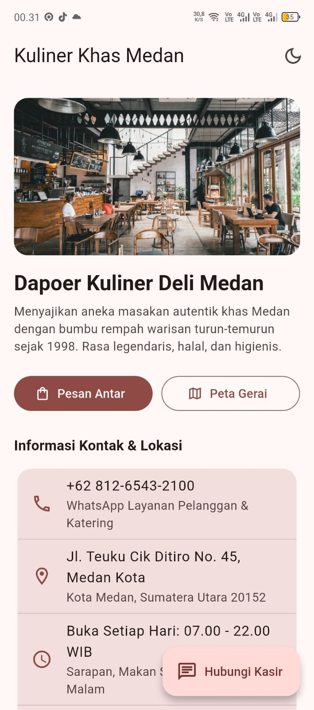
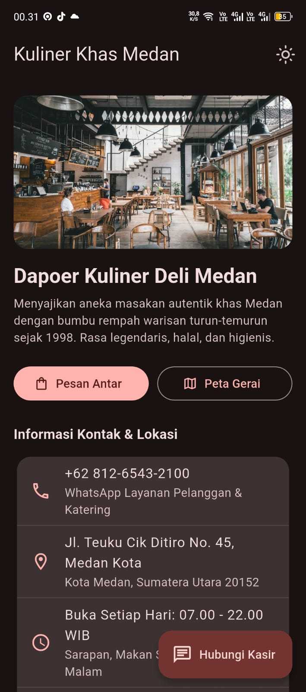
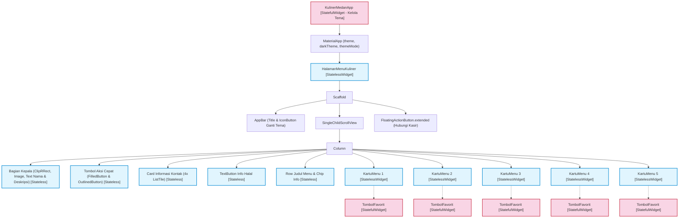

# Tugas Rutin 5: Halaman Menu UMKM Kuliner Medan
Mata Kuliah: **Pemrograman Mobile (3KOM40215)**  
Dosen Pengampu: **Adidtya Perdana, S.T., M.Kom**  
Program Studi: **Ilmu Komputer - Universitas Negeri Medan (UNIMED)**  

---

## (a) Identitas Mahasiswa
- **Nama**: Mahasiswa Pemrograman Mobile
- **NIM**: 4241250015

- **Nama UMKM**: Dapoer Kuliner Deli Medan
- **Bidang Usaha**: Kuliner Autentik Khas Medan

---

## (b) Tangkapan Layar Aplikasi

Aplikasi mendukung **Material Design 3**, palet warna dinamis dari `ColorScheme.fromSeed`, serta mode terang (*Light Mode*) dan mode gelap (*Dark Mode*). Pergantian tema dapat dilakukan langsung melalui tombol aksi di AppBar atau mengikuti tema sistem perangkat.

| Mode Terang (Light Theme) | Mode Gelap (Dark Theme) |
| :---: | :---: |
|  |  |

> *Catatan: Untuk menyimpan tangkapan layar, jalankan aplikasi pada emulator atau perangkat fisik Android, lalu simpan hasil tangkapan layar ke folder `docs/screenshots/light_mode.png` dan `docs/screenshots/dark_mode.png`.*

---

## (c) Diagram Widget Tree Halaman

Berikut adalah struktur hierarki **Widget Tree** aplikasi Halaman Menu UMKM Kuliner Medan beserta penanda jenis widget (**Stateless** vs **Stateful**):

### Keterangan Komponen:
- **Kotak Merah Muda**: `StatefulWidget` (memiliki data yang dapat berubah dan memanggil `setState()`).
- **Kotak Biru Muda**: `StatelessWidget` (tampilan immutable, hanya bergantung pada konfigurasi parameter).

---

## (d) Penjelasan Arsitektur Tiga Pohon dan Pemilihan State (168 kata)

Arsitektur Flutter dibangun di atas tiga struktur pohon yang bekerja secara harmonis: Widget Tree, Element Tree, dan RenderObject Tree. Widget Tree berperan sebagai konfigurasi deklaratif yang bersifat immutable ("apa yang ingin ditampilkan") dan dibuat ulang setiap kali metode `build()` dipanggil. Element Tree bertindak sebagai jembatan yang bertahan lama, mengelola siklus hidup komponen, menyimpan objek State, dan mencocokkan widget baru dengan widget lama. Sementara itu, RenderObject Tree bertanggung jawab menghitung geometri tata letak (*layout*) dan menggambar (*paint*) piksel ke layar secara efisien.

Dalam aplikasi ini, `HalamanMenuKuliner` dan `KartuMenu` dipilih sebagai `StatelessWidget` karena seluruh datanya (nama gerai, kontak, nama menu, harga, dan kategori) bersifat statis dan hanya menerima konfigurasi parameter dari luar tanpa perlu merender ulang seluruh antarmuka saat terjadi interaksi. Sebaliknya, `TombolFavorit` sengaja diisolasi sebagai `StatefulWidget` kecil agar perubahan status favorit hanya memicu `setState()` secara lokal pada elemen tombol itu sendiri. Pendekatan ini mencegah rekonstruksi yang tidak perlu pada widget induk, menjaga performa tetap optimal, serta memanfaatkan sifat element tree yang mempertahankan objek state tanpa merombak render tree.

---

## (e) Spesifikasi Implementasi Fitur

1. **Material Design 3 & ColorScheme Dinamis**:
   - Seluruh warna komponen diturunkan dari satu warna dasar rempah kuliner Medan (`seedColor: const Color(0xFF9E2A2B)`).
   - Tidak ada kode warna statis (*hardcoded*) di dalam widget antarmuka selain `seedColor` pada tema.
   - Mendukung tema terang dan tema gelap lengkap dengan tombol toggle interaktif.
2. **Bagian Kepala (Header) & Kontak**:
   - Menampilkan banner gambar kuliner, nama usaha **Dapoer Kuliner Deli Medan**, dan deskripsi singkat.
   - Kontak menggunakan `Card` yang memuat 4 baris `ListTile` (Telepon/WhatsApp, Alamat, Jam Operasional, dan Media Sosial).
3. **Daftar Menu dengan Widget Mandiri (`KartuMenu`)**:
   - Menyediakan 5 menu khas Medan: Lontong Sayur Medan Komplit, Soto Daging Sapi Kuah Santan, Mie Balap Seafood Krakatau, Bika Ambon Pandan Spesial, dan Kopi Sidikalang Susu Dingin.
   - Setiap menu ditampilkan oleh widget buatan sendiri `KartuMenu` (`StatelessWidget`) dengan parameter `nama`, `harga`, `kategori`, dan `deskripsi`.
   - Kategori ditampilkan menggunakan komponen Material 3 `Chip`.
4. **Tombol Favorit Interaktif (`TombolFavorit`)**:
   - Diimplementasikan sebagai `StatefulWidget` kecil berikon hati (`Icons.favorite_border` menjadi `Icons.favorite`).
   - Warna ikon otomatis menyesuaikan tema menggunakan `Theme.of(context).colorScheme.error`.
   - Memberikan umpan balik instan kepada pengguna berupa `SnackBar`.
5. **Komponen & Tombol Material 3 Beragam**:
   - `IconButton` (Tombol favorit & toggle tema)
   - `FilledButton.icon` (Pesan antar)
   - `OutlinedButton.icon` (Peta gerai)
   - `TextButton.icon` (Informasi sertifikasi halal)
   - `FilledButton.tonal` (Tambah item menu)
   - `FloatingActionButton.extended` (Hubungi kasir)
   - `Chip` (Kategori menu)
   - `Card` (Kontak dan menu)
6. **Uji Otomatis (Widget Testing)**:
   - Terletak di `test/widget_test.dart`.
   - Menguji interaksi penekanan tombol favorit, perubahan ikon hati, dan pemunculan `SnackBar`.
   - Menguji fungsi tombol penggantian tema terang/gelap.
   - Hasil eksekusi `flutter test`: **100% lulus (All tests passed)**.
   - Hasil analisis kode `flutter analyze`: **No issues found**.

---
